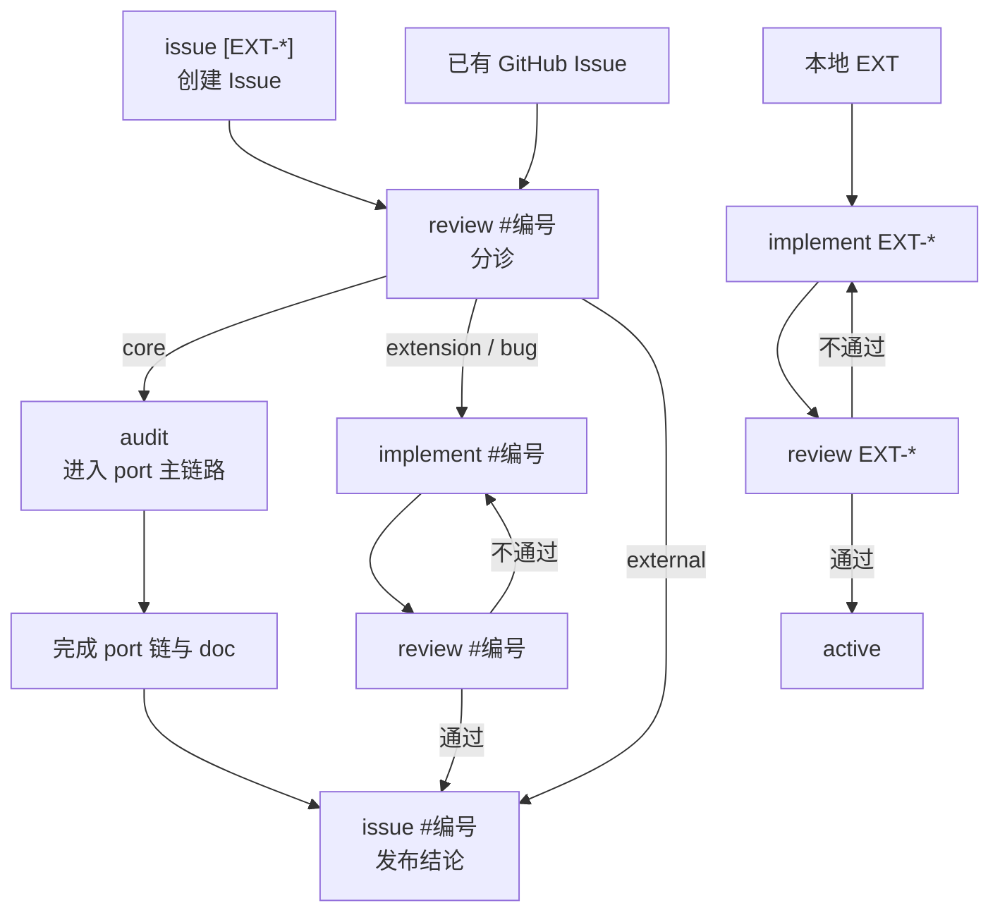

# `/pstack-port` 使用说明

用于从零移植、跟进上游更新、修复本地扩展或处理 GitHub Issue。`SKILL.md` 负责路由，`references/` 保存分支说明。一次调用只执行一个分支，后续阶段需要再次显式调用。

## 命令

```text
/pstack-port upstream
/pstack-port prepare
/pstack-port audit
/pstack-port implement <port|EXT-*|#编号>
/pstack-port review <port|EXT-*|#编号>
/pstack-port doc
/pstack-port issue [EXT-*|#编号]
```

`implement` 无参数时只让你选择本地工作项，不自动发现 GitHub Issue。`review #编号` 首次执行时分诊，实现后再次执行时审查。`issue` 无参数时创建新 Issue；带尚无追踪入口的 EXT 时为其创建 Issue；带 `#编号` 时验收。

每次公开 GitHub 操作都会展示目标仓库和完整内容，等待你确认。

## port 主链路


`upstream` 和 `prepare` 是前置，不开始 port 轮次。`audit` 重建中文 `pstack/README.md` 并开始轮次；`doc` 更新英文适配文档、README 最终覆盖并结束轮次。

## Issue 与本地 EXT



`core` 必须重新冻结 port 需求，不通过 `implement #编号` 直接改基线。`extension` 与 `bug` 只修改对应 EXT 或 FIX。`external` 只准备外部证据与公开结论。

## 状态与工作文件

| 文件 | 用途 |
|---|---|
| `docs/port-state.yaml` | 唯一 port 状态与 blocker；决定可执行路由 |
| `docs/port-review.md` | 当前 port 轮次证据；audit 重置，doc 清空正文 |
| `docs/port-fixes.yaml` | open/active FIX 与待 doc compact 的退役候选；replay 只跑 active |
| `docs/port-fixes-archive.yaml` | upstream-fixed/obsolete FIX 历史 |
| `docs/extensions.md` | EXT 登记与 proposed/active/broken/retired 状态 |
| `docs/extensions/<EXT-ID>/review.md` | 单个 EXT 的实现、修复落点与验收证据 |
| `docs/issues/<编号>/review.md` | Issue 分诊、映射、验收行为和公开状态 |

blocker 非空时，只允许它列出的路由，且每条路由仍检查自身前置。工作项串行处理，不能切换或并行处理另一个 Issue/EXT。验收成功后清 blocker，再按保存的路由恢复。

EXT 或 FIX 失效时按修复动作落点处理：只改扩展走 EXT 修复；必须改 port 基线走当前 port finding 或 core 轮次；只能改上游或 DSH 时记录证据并询问你。

## 文档与验证

`audit` 与 `doc` 写 README 前读取 upstream 的 `technical-writing` 和 `unslop` 技能。`pstack/README.md` 使用简体中文；主适配器 `pstack/harness/docs/harness/dsh.md` 按上游英文模板编写。

`doc` 覆盖当前全部可选插件的未启用降级说明，并在 `dsh.md` 的 `## Local replacements` 补齐 README 记录的运行期替代项（R-11）；写文档前和收尾时都运行 `vp run @internal/pstack#check:harness-doc`（R-12），它按 `docs/harness-doc.yaml` 对账 README、上游模板与 `src/`。随后核对根 README 的版本、统计、入口、能力、插件和兼容性动态内容。没有差异时不修改根 README。多语言版本需要同步更新。

`doc` 收尾、以及本技能整体重构后，各按 R-13 用 `/writing-for-agents` 做一次整文档审查（S-28、S-29）。`SPEC.md` 平时只追加；定期自洁按 [`SPEC-HYGIENE.md`](SPEC-HYGIENE.md)（R-14）。

通用门禁：

```bash
vp check
vp test
vp run @internal/pstack#check:harness-doc
node pstack/scripts/generate-pstack-harness-tree.mjs --check
node pstack/scripts/port-fixes.mjs replay
```

`doc`、`review port` 与 Issue 验收执行全部五条。每次分支报告都会给出完整的下一条 `/pstack-port ...` 命令；没有后续动作时报告“本轮结束，无下一步”。
