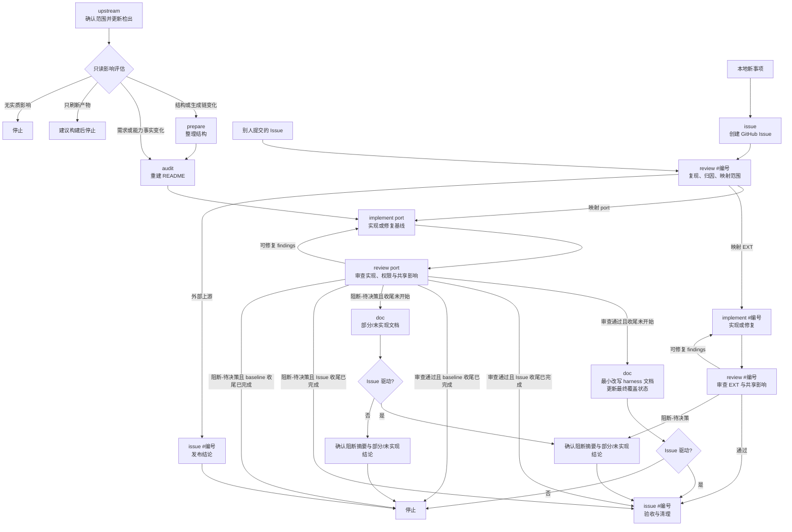

# `/pstack-port` 使用说明

用于从零建立、完整重建、跟进上游更新或处理 GitHub 事项。`SKILL.md` 只负责路由，`references/` 保存各分支说明；一次调用只执行一个分支，本说明供人阅读，不增加执行规则。

## 使用方式

```text
/pstack-port upstream
/pstack-port prepare
/pstack-port audit
/pstack-port implement <port|#编号>
/pstack-port review <port|#编号>
/pstack-port doc
/pstack-port issue [EXT-* 或 #编号]
```

未指定分支时，技能会询问。`implement` 与 `review` 必须显式指定 `port` 或 `#编号`；无参数调用只列出待处理范围并等待你选择，不会自动开始修复或审查。`EXT-*` 只作为 `issue` 的创建参数，或由 `#编号` 的映射得到。Issue 相关工作必须传 `#编号`；`issue` 无参数时创建本地新事项，可带一个尚无追踪入口的 `EXT-*`，或带 `#编号` 进入验收。公开的 GitHub 操作（创建、评论、重开、关闭、改标签）每次都需要你确认。

## 整体流程



`prepare` 只结束本次调用，不结束本轮移植：通过后续显式调用继续完整的 `audit → implement ⇄ review → doc`。它可以诊断生成问题，但不要求 `generate --check` 在适配文档更新前通过。存在活跃审查轮次时，`upstream`、`prepare` 与 `audit` 都会停止；先完成或明确放弃当前轮次再更新上游、整理结构或重建基线。基线部分完成后如需 GitHub 追踪，可由 `review #编号` 在 `用户确认` 已记录时建立新的 Issue 轮次。

## 范围与工作文件

Issue 编号是外部追踪标识；内部工作范围只有 `port` 或一个 `EXT-*`；`外部上游` 是外部责任层标记，不产生本仓实现范围。`port` 的原子能力、分层与证据规则见 [`references/port-baseline.md`](references/port-baseline.md)。

审查工作文件以 `轮次`（baseline 或 `#编号`）绑定来源，并记录 `审查对象` 与 `审查状态`：`未运行 → 待审查 → 通过/阻断-可修复/阻断-待决策`；`阻断-可修复` 修复后回到 `待审查`；`通过` 经 `doc` 正常模式、`阻断-待决策` 经 `doc` 部分模式后进入 `收尾状态：已完成`。`port` 另有 `收尾状态`。finding 状态为 `open/reopened/fixed-pending-review/closed/blocked`，`blocked` 只用于需要决策或缺少公共能力的项。

| 对象 | 需求与状态 | 审查工作文件 | 收尾 |
|---|---|---|---|
| `port` | `pstack/README.md` 的上游能力与分阶段状态 | `docs/port-review.md` | 正常 `doc` 保持 `审查状态：通过`、置 `收尾状态：已完成`；部分/未实现 `doc` 保持 `审查状态：阻断-待决策`、置 `收尾状态：已完成` |
| 一个 `EXT-*`（经 `#编号` 映射） | `docs/extensions.md` 中该编号条目 | `docs/extensions/<EXT-ID>/review.md` | 该 EXT 的 `issue` 验收成功后清理 |
| 一个 Issue（外部追踪） | GitHub Issue 与 `docs/issues/<编号>/review.md` 的范围映射 | 映射范围的审查工作文件 | `issue #编号` 验收成功后清理 |

每个内部范围独立实现、审查和清理。共享代码发生改动时，运行受影响的既有回归；发现必须改变另一范围的行为时，暂停当前收尾并显式切换范围，不顺带修改对方需求或状态。

## 分支边界

- `upstream`：只确认更新范围、更新检出并做只读分流，不运行构建。
- `prepare`：只整理 `pstack/` 的结构与生成链，不改需求、实现或适配文档内容。
- `audit`：只重建中文 `pstack/README.md` 与审查工作区，不读现有实现反推需求。
- `implement`：只按选定范围实现或修复；DSH 文本适配留给 `doc`。
- `review`：先做 Issue 分析；实现后才审查并更新当前范围台账，不改实现与测试。
- `doc`：只按上游模板最小生成英文适配文档，并更新 README 的文档与最终覆盖状态。
- `issue`：只发起或验收 GitHub 事项，不直接实现功能。

既定适配直接成为实现与验收基线；只有 `audit` 标为“待选择”的能力需要在 `implement` 前选定方案。除 README、根 `docs/`、本地适配树、runtime 及必要的插件集成与构建配置外，`pstack/` 的其他上游文档、技能和 playbook 保持原状。目录与构建链详见 `docs/architecture.md`。

## 目录与构建

`pstack/pstack/` 是生成树，`pstack/dist/` 是组装树，`dist/pstack/` 是随包树。主适配器 `claude-code.md` 映射为 `pstack/harness/docs/harness/dsh.md`，其他 harness 附件保持上游相对路径与文件名；runtime 走 `pstack/runtime/skills/<技能>/scripts/` → `pstack/dist/runtime/skills/<技能>/scripts/` → `dist/pstack/skills/<技能>/scripts/`。生成树与 `dist/` 只由构建生成。
