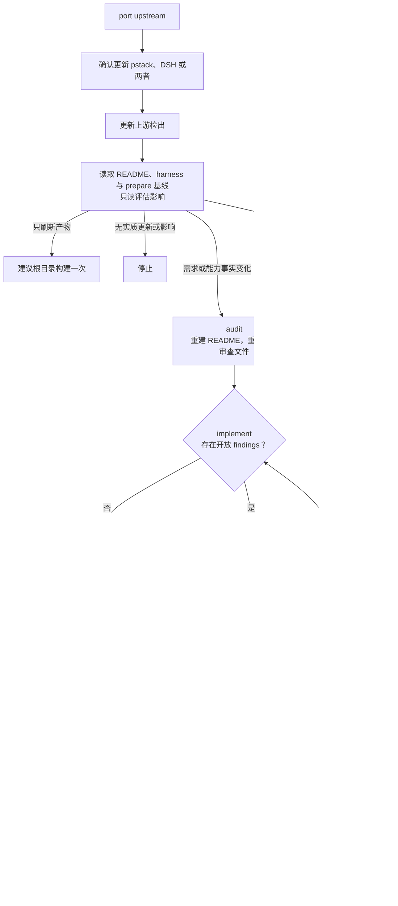

# `/pstack-port` 使用说明

用于从零建立、完整重建、跟进上游更新或扩展 DSH 版 pstack。`SKILL.md` 只负责路由，`references/` 保存上游更新、移植阶段与独立功能说明；每次只加载一个分支，完成该分支后停止。本说明供人阅读，不是额外执行分支。

## 使用方式

```text
/pstack-port upstream
/pstack-port prepare
/pstack-port audit
/pstack-port implement
/pstack-port review
/pstack-port doc
/pstack-port feature
```

未指定分支时，技能会询问，不自动执行完整流水线。

## 整体流程



已明确的基线实现偏差由 `implement` 与 `review` 处理；新增随包独立功能由 `feature` 实现。

## 阶段与确认门

1. `upstream`：确认更新 pstack、DSH 或两者及目标提交，更新检出，只读评估后建议构建、`prepare`、`audit` 或停止。不生成额外交接文件。
2. `prepare`：按上游 CC 适配方式整理目录、本地 harness 适配树、runtime 镜像、生成和脚本替换链路，生成 `docs/port-prepare.md`。只恢复结构，不做需求调查或功能实现。
3. `audit`：读取结构报告，清点上游文档和脚本、核对 DSH 能力与本仓既定适配，生成**中文** `pstack/README.md`，重置本轮 `docs/port-review.md` 并预留分阶段状态区。
4. `implement`：初次按既定适配实现；存在开放 findings 时自动读取报告并增量修复，无需附加说明。
5. `review`：详审受影响范围、复核整体门禁，检查 runtime 行为等价、插件范式、权限、最小实现与残留，保留本轮 findings 和修复历史。
6. `doc`：在实现审查通过后，按上游模板最小生成**英文** `pstack/harness/` 适配文档，更新 README 的最终完整/部分/未实现状态，并清理本轮审查工作文件。
7. `feature`：登记并实现 `EXT-*` 随包独立功能，核对公共接口、权限与真实行为，更新扩展状态；不进入移植的 audit/review 状态机。

既定适配直接成为实现与验收基线。只有 `audit` 标为“待选择”的能力需要你在 `implement` 前选定方案。允许修改 README、根 `docs/`、本地 harness 适配树、runtime 及必要的插件集成与构建配置；`pstack/` 的其他上游文档、技能和 playbook 保持原状。

## 目录与构建约定

```text
上游 pstack + pstack/harness/
  → pstack/pstack/
  → pstack/dist/pstack/
  → dist/pstack/

上游脚本镜像
  → pstack/runtime/skills/<技能>/scripts/
  → pstack/dist/runtime/skills/<技能>/scripts/
  → dist/pstack/skills/<技能>/scripts/
```

主适配器 `claude-code.md` 映射为 `pstack/harness/docs/harness/dsh.md`，其他 harness 附件保持上游相对路径与文件名。新增附件进入同一映射，不维护固定附件清单。runtime 保持上游脚本路径镜像，生成与替换机制保证随包只保留生产脚本。生成树与 `dist/` 只由构建生成。

## 独立功能流程

```text
明确用户需要的随包功能
→ 在 docs/extensions.md 登记需求与验收
→ 核对公共接口和权限
→ 实现并进行真实安装验收
→ 更新扩展状态
```

具体功能与编号由当次请求决定，技能不预置扩展示例。

## 分支选择

- 上游更新：`upstream`。
- 结构或生成链整理：`prepare`。
- 基线需求与能力审查：`audit`。
- 基线实现与审查修复：`implement`。
- 实现审查：`review`。
- harness 适配文档：`doc`。
- 随包独立功能：`feature`。
