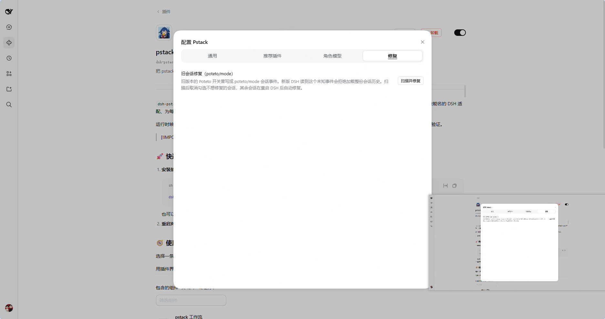

<div align="center">
  

  <h1>dsh-pstack</h1>

  <p>
    <strong>Bring pstack's rigorous agent workflows to DeepSeek Harness</strong>
  </p>

  <p>English · <a href="./README.zh.md">中文</a></p>

  <p>
    <a href="https://npmx.dev/package/dsh-pstack"></a>
    <a href="https://github.com/deepseek-ai/deepseek-harness">=0.2.3-alpha.2" /></a>
    <a href="https://github.com/cursor/plugins/tree/main/pstack"></a>
    <a href="https://github.com/l246804/dsh-pstack/blob/main/LICENSE"></a>
    <a href="https://dshopen.org/plugins/dsh-pstack/"></a>
    <a href="https://awesome-dsh-plugin.com"></a>
  </p>

  <table>
    <tr>
      <td align="center"><strong>59</strong><br /><sub>pstack skills</sub></td>
      <td align="center"><strong>22</strong><br /><sub>playbooks</sub></td>
      <td align="center"><strong>4</strong><br /><sub>plugin tools</sub></td>
      <td align="center"><strong>3</strong><br /><sub>subagent presets</sub></td>
    </tr>
  </table>

  <p>
    <a href="#quick-start">🚀 Quick start</a> ·
    <a href="#commands">⌨️ Commands</a> ·
    <a href="#configuration">🎛️ Configuration</a> ·
    <a href="#capabilities">🧩 Capabilities</a> ·
    <a href="#limitations">⚠️ Limitations</a> ·
    <a href="#compatibility">📦 Compatibility</a>
  </p>
</div>

---

`dsh-pstack` brings [pstack](https://github.com/cursor/plugins/tree/main/pstack)'s planning, implementation, review, and verification workflows to [DeepSeek Harness](https://github.com/deepseek-ai/deepseek-harness) (DSH), with the upstream skills, playbooks, and reference documents included.

- **Start from a task.** Use `/poteto-mode` for the full workflow, or choose a skill for a specific job.
- **Choose models by role.** Set each role's provider, model, and reasoning effort, or inherit the parent Session's route.
- **Coordinate subagents.** Delegate implementation, read-only research, and review; optionally use Agent Teams to track shared work.

See [Port verification](#-port-verification) for results from real DSH Web sessions and the [runtime mapping](./src/dsh.md) for how Cursor capabilities map to DSH.

<a id="quick-start"></a>

## 🚀 Quick start

> [!IMPORTANT]
> Requires DSH `>=0.2.3-alpha.2` and Node.js `>=24.22.3`. See [Compatibility](#compatibility) for each release's supported DSH range.

1. **Install the plugin.**

   ```sh
   dsh plugin --profile web add dsh-pstack
   ```

   You can also install it from the **Plugins** page in Web or Desktop.

2. **Restart the profile or open a new Session.**

3. **Start a task.** Invoke `/poteto-mode` and describe what you want to build or fix. Use `/poteto-help` to explore the workflows.

You can start with the parent Session's model. To choose models by role or keep the workflow active on every turn, see [Configuration](#configuration).

<a id="commands"></a>

## ⌨️ Common commands

| Task | Commands |
|---|---|
| Help | `/poteto-help` |
| Configure role models | `/setup-pstack` |
| Shape the request | `/reframe`, `/sharpen` |
| Plan and build | `/poteto-mode`, `/architect`, `/arena`, `/swarm` |
| Understand and investigate | `/how`, `/why`, `/teach` |
| Verify | `/create-verification-skill`, `/statechart` |
| Review and maintain | `/show-me-your-work`, `/retro`, `/docs-drift` |

<a id="configuration"></a>

## 🎛️ Configuration

Open **Plugins → Installed plugins → pstack → Configure**.

<details>
<summary>View the configuration entry</summary>


</details>

### Workflow switches

| Switch | Effect |
|---|---|
| **Poteto workflow** | Keeps the `poteto-mode` rules in the system prompt on every turn. Available under any preset except the built-in Minimal preset. |
| **Use Agent Teams** | Makes `pstack_subagent` start teammates that can track shared work on the Team board. |

The switches are independent and can be enabled together. Change them for the **current Session** in the model and reasoning menu. Set defaults for **new Sessions** on the configuration dialog's **General** tab.

<details>
<summary>View workflow switches and keyboard shortcut setup</summary>

**Current Session**


**Defaults for new Sessions**

Use **Default for new sessions** and **Default Agent Teams for new sessions** on the **General** tab.


**Keyboard shortcut**

Assign **Toggle Poteto workflow** in **Settings → General → Shortcuts** to toggle the current Session's Poteto switch from the keyboard.


</details>

### Role models

In **Role models**, choose a provider, model, and reasoning effort for each role, then save the changed row or use **Save all**. **Adjust budget** lets you preview and apply reasoning levels across roles.

You can also run `/setup-pstack` in a Session to discover available models and configure roles. Both paths save to `$DSH_HOME/pstack/models.json`; an unconfigured role inherits the parent route.

<details>
<summary>View role model settings</summary>


</details>

<a id="capabilities"></a>

## 🧩 Capabilities

### 🛠️ Plugin tools

The agent uses these tools during workflows; you can start with the [commands above](#commands).

| Tool | Function |
|---|---|
| `pstack_subagent` | Starts one subagent per call. Optionally selects an `agent_preset` or overrides the model route with `provider`, `model`, and `reasoning_effort`. |
| `pstack_interrupt` | Stops a pstack child's current turn by its name from `list_agents` or its Session id. Built-in presets disable the native `interrupt_agent`, so this is the interruption path. |
| `pstack_models` | Lists the providers, models, and reasoning efforts this deployment serves. |
| `pstack_roles` | Reports each role's configured routes, with the available reasoning efforts and defaults for each route. |

### 🎭 Agent presets

The package ships three child presets for delegation. You do not need to switch the parent Session's preset to invoke pstack skills.

| Preset | Use |
|---|---|
| `poteto-agent` | Handles implementation delegation with the pstack persona and `poteto-mode` instructions. |
| `comment-sicko` | Handles read-only comment review and reports deletion targets and `MUST KILL` symbols. |
| `readonly` | Provides a sandbox-enforced read-only researcher for inspection and evidence gathering. |

### 📚 Additional skills

These skills extend pstack with authoring, project-maintenance, and evidence-gathering workflows.

| Skill | Source | Use it to |
|---|---|---|
| `writing-for-agents` | `vendored` | Write or review a skill, `AGENTS.md`, `CLAUDE.md`, or another agent-facing document, including the `create-skill` use case. |
| `retro` | `vendored` | Review a coding session's environment for improvements to navigation, checks, conventions, tools, and information access. |
| `deslop` | `vendored` | Clean unnecessary comments, defensive code, casts, and nesting from a diff without changing behavior. |
| `control-ui` | `vendored` | Drive a local Web, IDE, or Electron interface and capture visual or accessibility evidence. |
| `control-cli` | `vendored` | Drive an interactive CLI or TUI and capture terminal transcripts or performance evidence. |
| `decision-write` | `authored` | Record a design choice, its rationale, and its implementation evidence through a traceable lifecycle. |
| `decision-audit` | `authored` | Check decision-record status, scope, implementation anchors, and supersession as design history grows. |
| `setup-project-docs` | `authored` | Establish architecture, glossary, decision conventions, and pointers for a project's documentation. |
| `docs-drift` | `authored` | Audit maintained documentation and repair approved drift, redundancy, and unsupported claims. |

[`skills/skills-lock.json`](./skills/skills-lock.json) records the sources and hashes of vendored skills.

## 🔌 Optional DSH plugins

These plugins are optional. In the configuration dialog's **Recommended plugins** tab, **Enable all** enables only the **Recommended** group (worktrees/PRs and Session history). Enable the other capabilities individually as needed.

<details>
<summary>View recommended plugin settings</summary>


</details>

| Use case | Plugin | What it provides and its boundaries |
|---|---|---|
| Worktrees and GitHub PRs | `@deepseek-ai/dsh-experimental-forge-bundle` | Local worktrees and GitHub PR workflows. GitHub status requires a logged-in `gh`. Without this plugin, use `gh` and `git worktree add` through `bash`. |
| Session history | `@deepseek-ai/dsh-experimental-session-search` | Read-only history and event inspection. It matches Sessions by exact `cwd`. Whether it includes subagent transcripts is unconfirmed. |
| Desktop verification | `@deepseek-ai/dsh-cua-bundle` | macOS desktop control in PTC desktop-control sessions. Windows support is incomplete. |
| Persistent terminals | `@deepseek-ai/dsh-experimental-terminal-bundle` | Persistent shell and REPL sessions for CLI and TUI verification. |
| Autonomous loops | `@deepseek-ai/dsh-experimental-ralph-bundle` | A foreground loop that starts a fresh child each round, rather than a persistent Session loop or event watcher. |

You can also enable packages through **Plugins → Add plugin**, then restart the profile when required. All listed packages ship with DSH as optional bundles. `@deepseek-ai/dsh-cua-bundle` runs on macOS only. See each plugin or skill's help for additional runtime requirements.

Steps that depend on a disabled plugin report skipped or blocked, never passed. See the [DSH adaptation guide](./src/dsh.md) for setup and fallbacks.

## 🧪 Port verification

The [validation results](./playground/results/README.md) show the latest observed behavior, handling decisions, and screenshots for each tested scenario. They distinguish the native DSH baseline from the adapted plugin. Mechanical checks and observed behavior are assessed separately; full run records remain local.

Validation uses real DSH Web sessions. Scenarios are revisited when their behavior or criteria change; a version bump alone does not imply a full rerun. See the [run guide](./playground/docs/run.md) to reproduce a scenario and the [scenario rules](./playground/docs/scenarios.md) for gap coverage and regression checks.

<a id="limitations"></a>

## ⚠️ Remaining gaps

These limits remain even with every optional plugin that can run alongside pstack enabled.

| Area | Limitation |
|---|---|
| Cursor platform services | No Automations, Cursor webhooks, `SendToUser`, cloud agents, or persistent cloud Projects. |
| Bugbot | Cannot start, configure, or wait for Bugbot. You can still handle existing Bugbot comments as PR reviews. |
| PR orchestration | No model-side change-request tool or shared PR tracking board and ledger. `watch-pr` still provides stack verdicts. |
| Event-driven loops | No forge event subscription. Local goals, schedules, and watchers are not equivalent. |
| Diagram rendering | No built-in renderer. Charts return Mermaid text. Render an image with your own tools when needed. |
| Media evidence | No built-in video rendering, recording, or frame-level verification. A project-owned renderer works when it produces a checkable file. Otherwise use external recording or FFmpeg. |
| Desktop coverage | Computer use is limited to macOS PTC desktop-control sessions. Windows support is incomplete. |
| MCP discovery | No automatic evidence-category discovery. Configure and identify MCP tools explicitly. |

## ❓ FAQ

<details>
<summary><strong>Preset names show in English</strong></summary>

Set the language to Chinese in **Settings → General → Language**, then restart DSH. The row may already show Chinese because it follows the browser. Select Chinese again. That saves the preference that preset names use when the host starts.

</details>

<details>
<summary><strong>Some rendering needs a plugin</strong></summary>

Native DSH renders images and SVG inline. A Mermaid diagram returns as text, and audio or video shows as a file card. Optional rendering plugins can extend this; see the [inline video validation](./playground/results/inline-video-playback/result.md) for the tested behavior.

</details>

<details>
<summary><strong>The model sometimes picks the wrong tool or path</strong></summary>

Model choice is probabilistic. The adapter wording and tool boundaries reduce how often it happens and how long recovery takes, but they cannot remove it. A retry usually resolves it. When it repeats, file a model behavior report with the retry result and the frequency.

</details>

<details>
<summary><strong>An older Session fails to load after upgrading</strong></summary>

If the error mentions a `poteto/mode` event, open **Configure → Repair → Scan and repair**. Scan Sessions, select the affected ones, and confirm the repair queue. Restart DSH to apply the repair.



</details>

## 📦 Compatibility

<a id="compatibility"></a>

Releases are grouped by their supported DSH range. Each table lists the dsh-pstack releases and the pstack version each bundles.

**DSH `>=0.2.2-rc.2`**

| dsh-pstack release | pstack version |
|---|---|
| `0.5.2` | `0.15.43` |

**DSH `>=0.2.2-rc.1`**

| dsh-pstack release | pstack version |
|---|---|
| `0.4.1` | `0.15.36` |
| `0.3.1` | `0.15.36` |

**DSH `>=0.2.1-rc.5`**

| dsh-pstack release | pstack version |
|---|---|
| `0.2.2` | `0.15.36` |

Older DSH baselines move to [compatibility history](./docs/compatibility-history.md).

## 🔗 Friendly links

- [LinuxDo - 新的理想型社区](https://linux.do/)

## 🤝 Contributing

Setup, the pull request check, commit and localization rules, and the merge requirement are in [CONTRIBUTING.md](./CONTRIBUTING.md). Bug reports are most useful with the DSH version, the dsh-pstack version, and the command or session that failed.

## 💛 Credits

- [pstack](https://github.com/cursor/plugins/tree/main/pstack), designed and open-sourced by Lauren Tan and the Cursor team. It is the foundation of this port.
- [DeepSeek Harness](https://github.com/deepseek-ai/deepseek-harness), developed by the DeepSeek team. It is the host platform for this plugin.
- [cursor-team-kit](https://github.com/cursor/plugins/tree/main/cursor-team-kit), the source of the vendored `deslop`, `control-ui`, and `control-cli` skills.
- [mattpocock/skills](https://github.com/mattpocock/skills), the source of the vendored `writing-for-agents` and `retro` skills.

This project is a community port, not an official Cursor or DeepSeek release.

## ☕ Sponsorship

If this project saves you time, you can buy me a coffee.

<details>
<summary>Payment codes</summary>

| WeChat | Alipay |
| :---: | :---: |
| <a href="./assets/sponsor-wechat.png"></a> | <a href="./assets/sponsor-alipay.png"></a> |

</details>

## 📄 License

Original dsh-pstack code and documentation use the [MIT license](./LICENSE) © [leiwang](https://github.com/l246804). Bundled upstream projects and vendored skills use their upstream licenses. See [Credits](#-credits).
