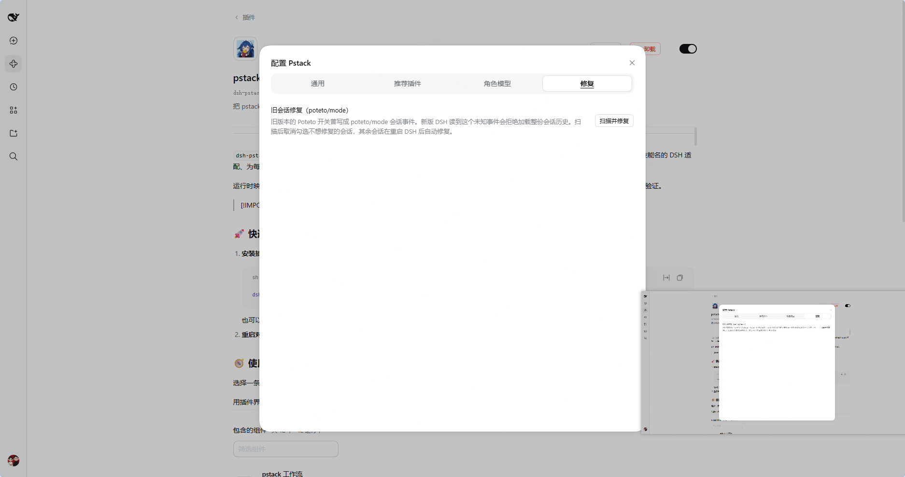

<div align="center">
  

  <h1>dsh-pstack</h1>

  <p>
    <strong>把 pstack 的严格代理工作流带进 DeepSeek Harness</strong>
  </p>

  <p><a href="./README.md">English</a> · 中文</p>

  <p>
    <a href="https://npmx.dev/package/dsh-pstack"></a>
    <a href="https://github.com/deepseek-ai/deepseek-harness">=0.2.3-alpha.2" /></a>
    <a href="https://github.com/cursor/plugins/tree/main/pstack"></a>
    <a href="https://github.com/l246804/dsh-pstack/blob/main/LICENSE"></a>
    <a href="https://dshopen.org/plugins/dsh-pstack/"></a>
    <a href="https://awesome-dsh-plugin.com"></a>
  </p>

  <table>
    <tr>
      <td align="center"><strong>58</strong><br /><sub>pstack 技能</sub></td>
      <td align="center"><strong>22</strong><br /><sub>playbook</sub></td>
      <td align="center"><strong>4</strong><br /><sub>插件工具</sub></td>
      <td align="center"><strong>3</strong><br /><sub>智能体预设</sub></td>
    </tr>
  </table>

  <p>
    <a href="#quick-start">🚀 快速开始</a> ·
    <a href="#️-常用命令">⌨️ 常用命令</a> ·
    <a href="#-能力">🧩 能力</a> ·
    <a href="#-可选-dsh-插件">🔌 可选插件</a> ·
    <a href="#-移植如何验证">🧪 移植如何验证</a> ·
    <a href="#️-仍存在的缺口">⚠️ 仍存在的缺口</a> ·
    <a href="#-常见问题">❓ 常见问题</a> ·
    <a href="#-兼容性">📦 兼容性</a>
  </p>
</div>

---

`dsh-pstack` 将 [pstack](https://github.com/cursor/plugins/tree/main/pstack) 移植到 [DeepSeek Harness](https://github.com/deepseek-ai/deepseek-harness)（DSH）。它随包提供上游的技能、playbook 与参考文档。在此基础上，它提供技能名的 DSH 适配、为每个角色指定模型路由、可显式指定路由的子代理，以及列出可用模型与角色并中断子代理的工具。

[运行时映射](./src/dsh.zh.md)给出每项 Cursor 能力到 DeepSeek Harness 的对应关系。移植由真实 DSH Web 会话验证，不靠比对文本，具体做法见[移植如何验证](#-移植如何验证)。

> [!IMPORTANT]
> 要求 DSH `>=0.2.3-alpha.2`、Node.js `>=24.22.3`。部分脚本需要额外运行时，见对应脚本自身的帮助信息。

<a id="quick-start"></a>

## 🚀 快速开始

1. **安装插件。**

   ```sh
   dsh plugin --profile web add dsh-pstack
   ```

   也可以在 Web 或 Desktop 的「插件」页面安装。

2. **重启对应的 profile，或新开一个会话。**

## 🧭 使用步骤

选择一条路径，展开查看完整步骤。

<details>
<summary><strong>🖥️ 可视化使用步骤</strong></summary>

用插件界面设置工作流默认值、启用相关插件并配置每个角色的路由。

1. 打开 **插件 → 已安装插件**，选择 **pstack 工作流**，然后点击 **配置**。

   

2. 在 **通用** 标签页，选择新会话是否默认开启 Poteto 工作流和智能体团队协作。

   

3. 在 **推荐插件** 中查看 **推荐** 和 **可选** 两组。**全部启用** 只会启用 **推荐** 组中的插件。

   

4. 打开 **角色模型**，为每个角色设置提供方、模型和推理强度，然后保存该行或点击 **全部保存**。

   

5. 打开 **修复**，对升级后需要更新的旧会话执行维护操作。

   

6. 在会话中打开模型与推理等级菜单，分别开启 **Poteto 工作流** 和 **启用智能体团队协作**。Poteto 工作流在除极简预设外的任何预设下可用。

   

</details>

<details>
<summary><strong>🧠 技能使用步骤</strong></summary>

需要从会话直接启动工作流时，使用对应的技能。

1. **初始化角色路由。** 运行一次 `/setup-pstack`。它会把检测到的路由写入 `$DSH_HOME/pstack/models.json`。缺少该文件时，角色继承父级路由。
2. **通过技能启动。** 直接输入 `/poteto-mode`。不需要先切换预设。
3. **使用针对性命令。** 从[常用命令](#️-常用命令)中选择一条。

</details>

## ⌨️ 常用命令

| 工作流 | 命令 |
|---|---|
| 帮助 | `/poteto-help` |
| 明确需求 | `/reframe`、`/sharpen` |
| 规划与实现 | `/poteto-mode`、`/architect`、`/arena`、`/swarm` |
| 理解与调查 | `/how`、`/why`、`/teach` |
| 验证 | `/create-verification-skill`、`/statechart` |
| 审查与维护 | `/show-me-your-work`、`/retro`、`/docs-drift` |

## 🧩 能力

### 🛠️ 插件工具

| 工具 | 作用 |
|---|---|
| `pstack_subagent` | 用 `agent_preset` 启动一个子代理，可用 provider、model 和 reasoning_effort 覆盖路由。 |
| `pstack_interrupt` | 按 `list_agents` 的名称或会话 id 中断一个 pstack 子代理当前回合。内置预设禁用了原生 `interrupt_agent`，所以这是中断通道。 |
| `pstack_models` | 列出本部署实际提供的 provider、model 和 reasoning effort。 |
| `pstack_roles` | 报告每个角色已配置的路由，以 provider、model 和 reasoningEffort 给出，并附该路由的可用 efforts 和默认档位。 |

### 🎛️ 工作流开关

Poteto 工作流和智能体团队协作是两个独立开关，可以在同一个会话里同时开启。Poteto 工作流在除极简预设外的任何预设下可用。

- **Poteto 工作流** 每轮把 poteto-mode 规则保留在系统提示里。
- **启用智能体团队协作** 让 `pstack_subagent` 启动团队成员，因此 pstack 委派可以在团队任务板上跟踪共享工作。

在模型与推理等级菜单里设置当前会话的开关。新会话的默认值在 Pstack 配置弹窗的 **通用** 标签页里设置，对应 **新会话默认开启** 和 **新会话默认开启智能体团队协作**。

<details>
<summary><strong>⌨️ 用快捷键切换</strong></summary>

想用键盘切换 Poteto 工作流开关，可以在 **设置 → 通用设置 → 快捷键** 里给 **切换 Poteto 工作流** 设置一个快捷键。快捷键切换的是当前会话的开关。


</details>

### 🎭 智能体预设

随包提供三个委派子代理预设。

| 预设 | 范围 | 用途 |
|---|---|---|
| `poteto-agent` | 子代理 | 实现型子代理，注入 pstack 人格和 `poteto-mode` 指令。 |
| `comment-sicko` | 子代理 | 只读评论评审子代理，报告删除目标和 `MUST KILL` 符号。 |
| `readonly` | 子代理 | 带只读沙箱的研究子代理，用于检查和取证。 |

### 📚 额外技能

这些技能为 pstack 补充文档编写、项目维护和证据采集工作流。

| 技能 | 来源 | 使用场景 |
|---|---|---|
| `writing-for-agents` | `vendored` | 编写或评审技能、`AGENTS.md`、`CLAUDE.md` 等智能体文档，覆盖 `create-skill` 的使用场景。 |
| `retro` | `vendored` | 复盘编码会话的智能体环境，改进导航、自动化检查、编码约定、工具效率和信息获取。 |
| `deslop` | `vendored` | 在不改变行为的前提下，清理 diff 中多余的注释、防御性代码、类型断言和嵌套。 |
| `control-ui` | `vendored` | 操作本地 Web、IDE 或 Electron 界面，采集视觉或可访问性证据。 |
| `control-cli` | `vendored` | 操作交互式 CLI 或 TUI，采集终端操作记录或性能证据。 |
| `decision-write` | `authored` | 以可追踪的生命周期记录设计取舍、理由和实现证据。 |
| `decision-audit` | `authored` | 在设计历史累积后，检查记录状态、范围、实现锚点和取代关系。 |
| `setup-project-docs` | `authored` | 为项目建立架构、术语、决策约定和文档指针。 |
| `docs-drift` | `authored` | 巡检持续维护的文档，修复获批的漂移、冗余和无依据表述。 |

vendored 技能的来源与哈希记录在 [`skills/skills-lock.json`](./skills/skills-lock.json)。

## 🔌 可选 DSH 插件

安装 dsh-pstack 时无需一并安装这些插件，按需启用即可。

| 使用场景 | 插件 | 提供的能力与边界 |
|---|---|---|
| 工作树与 GitHub PR | `@deepseek-ai/dsh-experimental-forge-bundle` | 提供本地工作树和 GitHub PR 工作流。GitHub 状态需要已登录的 `gh`。没有此插件时，通过 `bash` 使用 `gh` 与 `git worktree add`。 |
| 历史会话 | `@deepseek-ai/dsh-experimental-session-search` | 只读检索历史会话与事件，按 `cwd` 完全匹配。是否包含子代理会话记录尚未确认。 |
| 桌面验证 | `@deepseek-ai/dsh-cua-bundle` | 在 macOS PTC 桌面控制会话中控制桌面。Windows 支持尚不完整。 |
| 持久终端 | `@deepseek-ai/dsh-experimental-terminal-bundle` | 为 CLI 和 TUI 验证提供持久终端与 REPL 会话。 |
| 自主循环 | `@deepseek-ai/dsh-experimental-ralph-bundle` | 每轮启动新子代理的前台循环，不是同一会话的常驻循环或事件监听器。 |

通过 **插件 → 添加插件** 启用对应包，必要时重启 profile。以上插件均随 DSH 作为可选插件提供，`@deepseek-ai/dsh-cua-bundle` 仅在 macOS 上运行。

依赖未启用插件的步骤会标记为已跳过或已阻止，不会标记为通过。安装与回退说明见 [DSH 适配文档](./src/dsh.zh.md)。

## 🧪 移植如何验证

移植由真实 DeepSeek Harness Web 会话验证，不靠与上游比对文本。完整流程见 [playground/docs/run.md](./playground/docs/run.md)。

- **native 基准。** `native/` 钉定上游 pstack 并生成 `native/pstack`；`native/dsh.md` 把每个 Cursor 名称映射到 DSH 替代项，并写清替代项不可用时的 fallback。生成器把该文档插入生成树，上游文案保持原样。
- **场景驱动。** 覆盖来自 `native/gaps.json` 与 `playground/scenarios/` 下的场景文件；缺口清单记录 DSH 标准运行时缺少的能力，场景负责验证这些缺口。
- **语义审核。** 技能能加载，只证明它可被触达。每个场景单独记录 `supported`、`gap` 或 `inconclusive` 结论，并附审核者与理由。adapted 运行记录 `verified`、`not-verified` 或 `inconclusive`。
- **adapted 复验。** 审核结论驱动 [src/dsh.zh.md](./src/dsh.zh.md)。用 `vp run build` 重建适配包，再重跑同一批场景，确认映射后的行为。
- **环境矩阵。** 能力探针默认在 `base` 运行。`render` 是渲染对照环境。`agent-team` 是开启团队协作的环境，用于验证开启智能体团队协作后的 pstack 委派。

## ⚠️ 仍存在的缺口

即使启用所有能与 pstack 共存的可选插件，以下限制仍然存在。

| 领域 | 限制 |
|---|---|
| Cursor 平台服务 | 不支持 Automations、Cursor webhook、`SendToUser`、云代理和持久云端 Projects。 |
| Bugbot | 无法启动、配置或等待 Bugbot。已有的 Bugbot 评论仍可作为 PR 评审处理。 |
| PR 编排 | 没有模型侧变更请求工具，也没有共享的 PR 跟踪面板与记录。`watch-pr` 仍提供 PR 栈判定。 |
| 事件驱动循环 | 不订阅 forge 事件。本地目标、定时任务和事件监听器并非等价替代。 |
| 图表渲染 | 不提供内置渲染器。图表以 Mermaid 文本返回。需要图片时自行用外部工具渲染。 |
| 视频证据 | 没有内置视频渲染、录屏与逐帧验证。项目自带的渲染器只要产出可核对的文件即可使用。否则借助外部录屏或 FFmpeg。 |
| 桌面覆盖 | 桌面操作仅支持 macOS PTC 桌面控制会话，Windows 支持尚不完整。 |
| MCP 发现 | 不会自动发现证据类别，需要显式配置并识别 MCP 工具。 |

## ❓ 常见问题

<details>
<summary><strong>展开查看问题与解答</strong></summary>

1. **预设名称显示为英文**

   在「设置 → 通用 → 语言」中把语言切换为中文，然后重启 DSH。语言行可能已经显示中文，因为它跟随浏览器。重新选择一次中文，会写入预设名称在宿主启动时读取的语言偏好。

2. **部分渲染需要插件**

   原生 DSH 能内联显示图片和 SVG。Mermaid 图以文本返回，音频或视频只显示文件卡片。这属于预期降级，不是技能失效。需要完整体验时，可以安装增强原生渲染能力的可选插件。

3. **模型偶尔选错工具或读错路径**

   模型选择有概率性。适配文档的措辞和工具边界能降低发生率和恢复成本，但无法消除。重试通常就能恢复。反复出现时，用模型行为报告提交，附上重试结果和出现频率。

</details>

## 📦 兼容性

按发布版本声明的 DSH 范围选择。每个范围一张小表，列出各发布版本及其打包的 pstack 版本。

**DSH `>=0.2.2-rc.2`**

| dsh-pstack 发布版本 | pstack 版本 |
|---|---|
| `0.5.2` | `0.15.43` |

**DSH `>=0.2.2-rc.1`**

| dsh-pstack 发布版本 | pstack 版本 |
|---|---|
| `0.4.1` | `0.15.36` |
| `0.3.1` | `0.15.36` |

**DSH `>=0.2.1-rc.5`**

| dsh-pstack 发布版本 | pstack 版本 |
|---|---|
| `0.2.2` | `0.15.36` |

更早的 DSH 基线移到[兼容历史](./docs/compatibility-history.zh.md)。

## 🔗 友情链接

- [LinuxDo - 新的理想型社区](https://linux.do/)

## 🤝 参与贡献

环境、PR 检查、提交与本地化规则、合并要求见 [CONTRIBUTING.zh.md](./CONTRIBUTING.zh.md)。报告问题时请附 DSH 版本、dsh-pstack 版本，以及出问题的命令或会话。

## 💛 鸣谢

- [pstack](https://github.com/cursor/plugins/tree/main/pstack)，由 Lauren Tan 与 Cursor 团队设计并开源，是本项目的工作流基础。
- [DeepSeek Harness](https://github.com/deepseek-ai/deepseek-harness)，由 DeepSeek 团队开发，是本插件的运行平台。
- [cursor-team-kit](https://github.com/cursor/plugins/tree/main/cursor-team-kit)，是 vendored `deslop`、`control-ui` 与 `control-cli` 技能的来源。
- [mattpocock/skills](https://github.com/mattpocock/skills)，是 vendored `writing-for-agents` 与 `retro` 技能的来源。

本项目是社区移植，不是 Cursor 或 DeepSeek 官方发行。

## ☕ 赞助

如果这个项目为你节省了时间，欢迎请我喝杯咖啡。

<details>
<summary>赞助码</summary>

| 微信 | 支付宝 |
| :---: | :---: |
| <a href="./assets/sponsor-wechat.png"></a> | <a href="./assets/sponsor-alipay.png"></a> |

</details>

## 📄 许可证

本仓原创代码与文档采用 [MIT License](./LICENSE) © [leiwang](https://github.com/l246804)。上游项目及 vendored 技能按各自的许可证使用。详见[鸣谢](#-鸣谢)。
