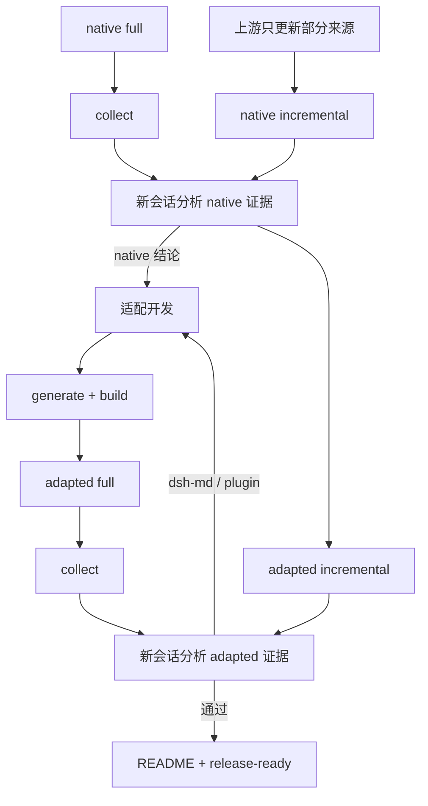

# Playground 验证流程

本文件定义 playground 的运行矩阵、命令、批次和交接条件。所有命令在仓库根执行，Linux 是 playground worker 运行时唯一支持的平台。

## 运行矩阵模型

- 一个 probe 定义只写一份，位于 `playground/scenarios/probes/*.ts`（扁平，一文件一能力）；probe 用 `treatments`（默认 native + adapted）和 `environments`（默认 `["base"]`）声明自己在哪些运行单元里成立。
- 运行单元是 treatment × environment：`treatment` 取 `native` | `adapted`；`environment` 的 id、可选插件与 team 模式都定义在 `runner/scenario/environments.ts`，文档不枚举。
- 每个单元只保留一份当前完整快照：`evidence/runs/<treatment>-<environment>/`。
- `manifest.json` 记录 `treatment`、`environment`、`dshVersion`、`pstackVersion`、`scenarioIds`，以及最后批次、mode 和覆盖场景。
- `evidence/runs/<treatment>-<environment>/scenarios/**` 保存每个场景的 `record.json`、`screenshot.png`；`session.jsonl.zstd` 只保留本地，不提交。
- 根因问答按 treatment 手写到 `playground/evidence/findings/<treatment>.md`，按能力打标签。
- `evidence/runs/.staging/` 是批次运行中的临时目录，不提交。
- 状态表和跨单元透视由 `playground:status-table` 从记录生成；对比由 `playground:compare` 按运行身份生成。

## 批次

- `run-batch --treatment <native|adapted> --environment <ID> --full`：覆盖该单元声明的全部适用场景（`scenario.treatments` 含该 treatment 且 `scenario.environments` 含该 environment），成功后整份当前快照更新。
- `run-batch --scenarios`：增量批次，只替换本次跑到的场景；未跑到的场景保留当前快照。
- `run-batch --only-failed`：native 只选择 gap，adapted 只选择 not-verified。
- `batchId` 在批次启动时生成，不按记录时间推导；它只写入 `current-batch.json` 和 `manifest.json`。
- 同一单元只允许一个批次写入；批次失败时 `.staging` 丢弃，当前快照不动。

## 语义审核（必需阶段）

collect 之后、分析并写入 `playground/evidence/findings/<treatment>.md` 之后，在进入 `playground:redact` 之前必须完成语义审核：

1. 手写 `evidence/runs/<treatment>-<environment>/review.json`，按 `scenarioId` 映射到 `{ "status": "supported" | "gap" | "inconclusive", "reason": "...", "reviewer": ... }`。`reviewer` 为 `{ "kind": "human", "name": "..." }` 或 `{ "kind": "model", "route": { "provider": "...", "model": "...", "effort": "..." } }`。
2. 运行 `vp run playground:review -- --treatment <treatment> --environment <environment> --apply`，把每条审核写回对应 `record.json` 并重算 verdict。
3. 运行 `vp run playground:review -- --treatment <treatment> --environment <environment> --check`，确认没有遗留 pending 记录。

这是记录从 pending 变为 verified / not-verified 的唯一路径。缺这一步，native 记录停在 unobserved，adapted 记录停在 inconclusive。

## 闭环总览



## 阶段交接

| 阶段 | 进入条件 | 产物 | 出口 |
| --- | --- | --- | --- |
| 1. native 验证 | 无当前 native 快照 | `evidence/runs/native-<environment>/` 当前快照 | 分析写入 `playground/evidence/findings/native.md` |
| 2. native 分析 | native 快照完整 | `playground/evidence/findings/native.md` 与 dsh.md 审查 | `dsh-md` / `plugin` / `upstream` / `ignore-environment` / `待你判断` 分流 |
| 3. 适配开发 | 分析给出当前单元的结论 | 更新当前单元的 dsh.md、适配代码、生成树和 build | adapted/<environment> |
| 4. adapted 验证 | 新 build 完成 | `evidence/runs/adapted-<environment>/` 当前快照 | 分析写入 `playground/evidence/findings/adapted.md` |
| 5. adapted 分析 | adapted 快照完整 | `playground/evidence/findings/adapted.md` 与当前单元 dsh.md 审查 | 通过后进 README/release-ready；可选环境按需补跑 |
| 6. 可选环境 | 需要环境对照时 | `evidence/runs/<treatment>-<environment>/` 当前快照 | 对应分析 |
| 7. README + release-ready | 分析通过 | README/兼容表、`vp run ci` 通过 | 用户手动 `vp run release` |

每个 treatment 的 collect 与分析之后，都要先按“语义审核（必需阶段）”写 `review.json` 并运行 `playground:review`，然后才能 redact 并进入下一阶段。

## 命令

### native

```sh
vp run playground:native-generate
vp run playground:prepare -- --treatment native --environment base --reset
vp run playground:bootstrap -- --treatment native --environment base --all
vp run playground:run-batch -- --treatment native --environment base --full
vp run playground:collect -- --treatment native --environment base
```

然后在新的分析会话按 [evidence-analysis.md](./evidence-analysis.md) 填写 `playground/evidence/findings/native.md`。

### adapted/base

```sh
vp run playground:prepare -- --treatment adapted --environment base --reset
vp run playground:bootstrap -- --treatment adapted --environment base --all
vp run playground:run-batch -- --treatment adapted --environment base --full
vp run playground:collect -- --treatment adapted --environment base
```

### 可选环境对照

可选环境用于同题对照，具体环境 id 与插件配置由 `runner/scenario/environments.ts` 定义。一个 probe 可声明多个 `environments`，在 base 与该环境各跑一次同一任务和观察。

```sh
vp run playground:prepare -- --treatment <native|adapted> --environment <environment> --reset
vp run playground:bootstrap -- --treatment <native|adapted> --environment <environment> --all
vp run playground:run-batch -- --treatment <native|adapted> --environment <environment> --full
vp run playground:collect -- --treatment <native|adapted> --environment <environment>
```

同时保留 base 的同题结果，才能判断差异来自环境还是适配。

### 补充环境 probe

可选环境按需启用，不默认运行：

```sh
vp run playground:prepare -- --treatment adapted --environment <supplemental-environment> --reset
vp run playground:run-batch -- --treatment adapted --environment <supplemental-environment> --full
vp run playground:collect -- --treatment adapted --environment <supplemental-environment>
```

### 增量与上游更新

上游更新只影响部分来源时，先用 diff 把改动映射到能力和场景，再跑对应增量：

```sh
vp run playground:run-batch -- --treatment native --environment base --scenarios <changed-scenario-a>,<changed-scenario-b>
vp run playground:collect -- --treatment native --environment base
```

完成 port 修改后，用同一批场景跑 adapted 增量：

```sh
vp run playground:run-batch -- --treatment adapted --environment base --scenarios <changed-scenario-a>,<changed-scenario-b>
vp run playground:collect -- --treatment adapted --environment base
```

增量批次只替换本次跑到的场景；当前快照里其他场景保持不变。需要吸收增量、建立新基线时再跑一次 `--full`。

### 审核与生成

collect 与分析之后，用 `playground:review` 把 `review.json` 应用到记录；状态表和跨单元对比由生成器产出：

```sh
vp run playground:review -- --treatment <native|adapted> --environment <ID> --apply
vp run playground:review -- --treatment <native|adapted> --environment <ID> --check
vp run playground:status-table -- --write
vp run playground:status-table -- --check
vp run playground:compare -- --environment <ID> --all
```

`--check` 版本供 CI 和提交前校验使用；状态表没有任何快照时 `--check` 直接通过。

## 分析分流

每个问题只能落到以下一种结论。这里的“类型”是后续动作分流；判定原则见 [evidence-analysis.md](./evidence-analysis.md)。

- `dsh-md`：改当前单元对应的 dsh.md；native 改 `playground/fixtures/native/dsh.md`，adapted 改 `port/dsh.md`，必要时同步 `dsh.zh.md`。
- `plugin`：改插件、工具或预设，build 后跑受影响场景。
- `upstream`：记录为上游问题，不在本仓修。
- `ignore-environment`：记录环境权限、凭据、网络或无头限制。
- `待你判断`：证据不足或分类会影响方案，交用户决定。

native 分析只对照 `playground/fixtures/native/dsh.md`，adapted 分析只对照 `port/dsh.md`。具体判定原则和 finding 格式见 [evidence-analysis.md](./evidence-analysis.md)，结论必须由证据和根因支撑，不能把单一观察直接等同于适配说明缺陷。

## dsh.md

- `playground/fixtures/native/dsh.md` 是 native 基准答案，`port/dsh.md` 是最终随包答案，两者不能合并。
- 分析只提出适配说明的修改建议；实际修改由人确认后写入。
- dsh.md 只描述 DSH 能力，不写具体插件、包、外部二进制或服务的安装建议；可选能力用能力名称说明。
- 本地化版 `dsh.zh.md` 是逐行翻译，只供审阅，生成器不读；其他 locale 按同一规则扩展。
- `playground/fixtures/native/dsh-evidence.md` 保存判定依据。

## 发版

更新根 `README.md`、`README.zh.md`、`port/AGENTS.md`、`docs/architecture.md`，然后：

```sh
vp run compatibility:check
vp run ci
```

agent 停在 release-ready。`vp run release` 由用户手动执行。
